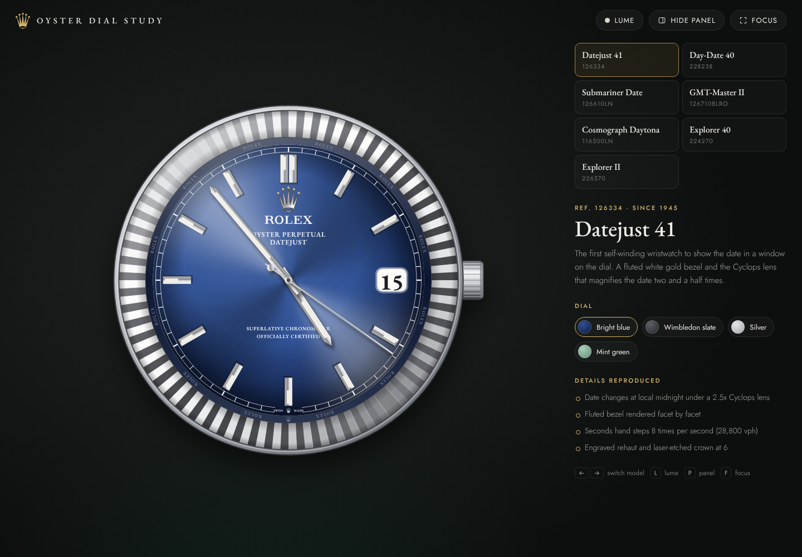
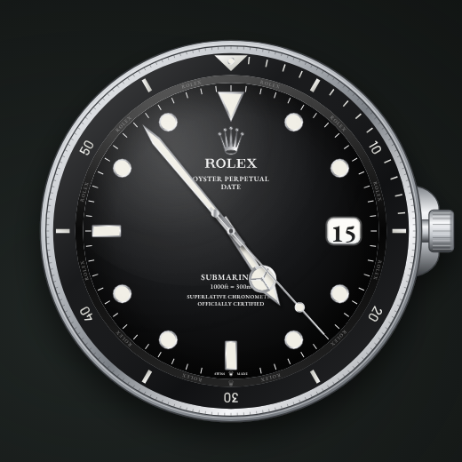
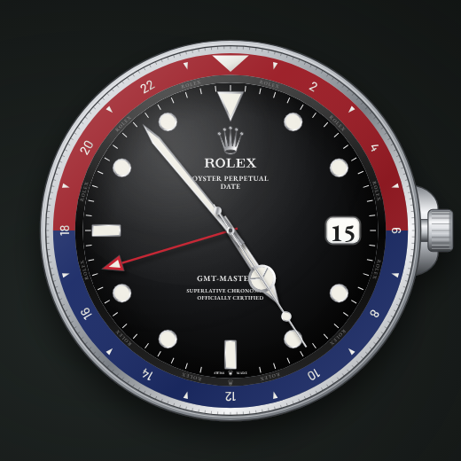
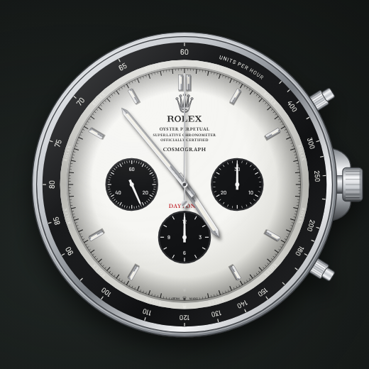
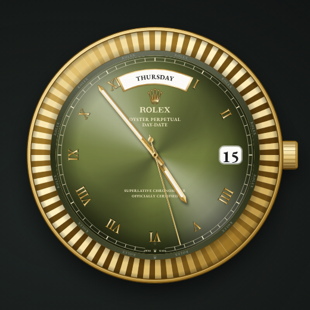
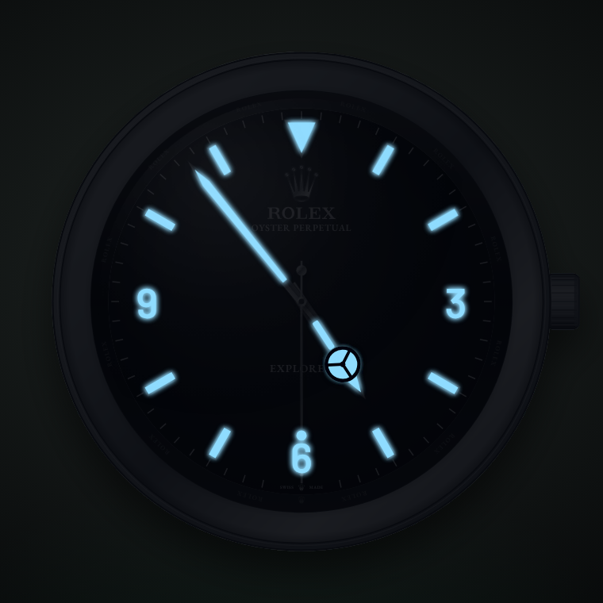

# Oyster Dial Study

Classic Rolex watch faces, redrawn in the browser and set to your local time.

Every part of the watch is drawn as SVG: case, crown, bezel, dial, hands and lume. There are no images of real watches and no libraries, just HTML, CSS and JavaScript.



| Submariner | GMT-Master II | Daytona | Day-Date | Lume mode |
|---|---|---|---|---|
|  |  |  |  |  |

## Run it

Clone the repo and open `index.html` in a browser. There's nothing to install or build.

```bash
git clone https://github.com/wonjyou/rolex-watchface.git
cd rolex-watchface
open index.html        # macOS. On Windows use: start index.html
```

It also works as-is on GitHub Pages (Settings > Pages > deploy from the `main` branch). Pages on a private repo needs a paid GitHub plan.

## Models

| Model | Reference | Dials |
|---|---|---|
| Datejust 41 | 126334 | Bright blue, Wimbledon slate, Silver, Mint green |
| Day-Date 40 | 228238 | Champagne, Olive green, Ice blue in platinum |
| Submariner Date | 126610LN | Black, Green bezel, Green sunburst |
| GMT-Master II | 126710BLRO | Pepsi, Coke, Batman |
| Cosmograph Daytona | 116500LN | White "panda", Black |
| Explorer 40 | 224270 | Black |
| Explorer II | 226570 | Polar white, Black |

## Details

- The seconds hand ticks 8 times a second, the same 28,800 beats per hour as a Rolex movement.
- The date flips at local midnight under a Cyclops lens. The Day-Date spells out the day in the arc at 12.
- The Submariner bezel only turns anticlockwise, in 120 clicks. Drag it, scroll over it, or use the buttons. It clicks.
- The GMT-Master II has a 24-hour hand you can set to any time zone, and a bezel that turns both ways in 48 clicks.
- The Daytona chronograph works. The top pusher starts and stops it. The bottom one resets it, but only when it's stopped, like the real thing.
- The Explorer II's orange 24-hour hand tells AM from PM.
- Also included: fluted bezels shaded facet by facet, the engraved ROLEX ring inside the bezel, SWISS MADE at 6, and the tiny crown etched into the crystal.

## Keys

| Key | Action |
|---|---|
| `←` `→` | Switch model |
| `L` | Lume mode |
| `P` | Show or hide the side panel |
| `F` | Focus mode (watch only) |
| `Space` | Start and stop the Daytona chronograph |

The URL keeps your model and dial, so `index.html#gmt/pepsi` opens straight to the Pepsi.

## How it's built

```
index.html        page layout
styles.css        styling, lume mode, mobile layout
js/models.js      models and dials: colours, text layout, features
js/watch.js       draws the watch as SVG
js/app.js         keeps time, handles clicks and drags, runs the side panel
assets/           Rolex wordmark and crown
docs/             screenshots for this README
```

To add a watch, add an entry to `js/models.js`. The renderer already supports fluted, smooth, diver, GMT, tachymeter and fixed 24-hour bezels, plus baton, Roman, dot and Explorer markers.

## Disclaimer

This is a fan project made for fun. It isn't affiliated with or endorsed by Rolex. Rolex, the crown logo, Oyster Perpetual and all model names are trademarks of Rolex SA.
